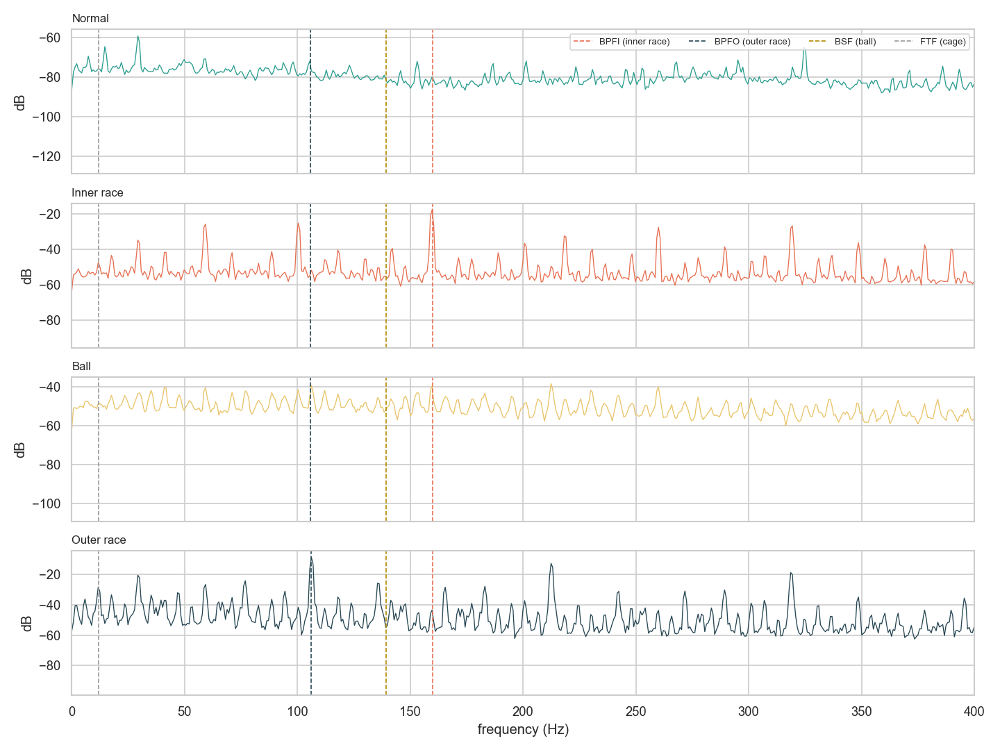
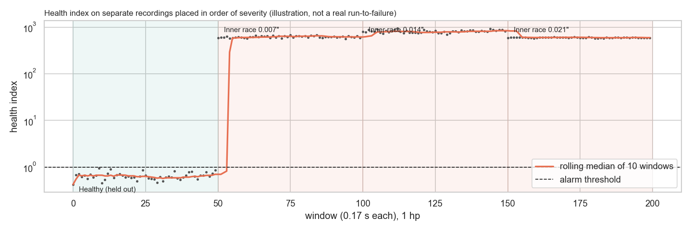

# Motor Bearing Failure Prediction from Vibration

Small mills (rice, flour, textile) lose a day of production when a motor bearing fails without warning.
Bearings don't fail suddenly, though: a small spall on a race sends a short impact every time a ball rolls over it,
months before the bearing seizes. This project detects those faults early from a short vibration recording.

Two models:
1. **Early warning (baseline detector):** learns a motor's own healthy vibration and flags drift. No fault labels needed,
   so it works on any motor or fan, including phone recordings.
2. **Fault diagnosis (classifier):** says *where* the fault is: inner race, outer race or ball.

The project includes the full analysis notebook, a **Flask** API, a **Streamlit** UI, and Docker/Render deployment.

**Live demo** (Render free tier; the first visit after ~15 minutes idle takes up to a minute to wake up):
- UI: https://bearing-fault-ui.onrender.com
- API: https://bearing-fault-api.onrender.com/health

## Results

Data: [CWRU bearing dataset](https://engineering.case.edu/bearingdatacenter), 12 kHz drive-end accelerometer, 40 recordings
(healthy + inner race / ball / outer race faults of 0.007", 0.014", 0.021", motor loads 0-3 hp).

**Fault-type classifier.** Accuracy, every split is by recording, never by window:

| Model | Random window split (leaky) | Unseen motor load (LOLO) | Unseen fault size (LOSO) |
|---|---|---|---|
| Baseline: LogReg, time-domain only | 0.839 | 0.825 | 0.587 |
| LogReg, generic features | 0.997 | 0.999 | 0.537 |
| **LogReg, generic + physics** (production) | 1.000 | **0.999** | **0.684** |
| Random forest, generic + physics | 1.000 | 0.979 | 0.638 |
| XGBoost, generic + physics | 1.000 | 0.947 | 0.699 |

**Early-warning detector.** Healthy baseline from the first half of each healthy recording (loads 0-3):
**100% of fault windows flagged at every fault size, including the smallest 0.007" (0.18 mm)**, and 0-1.7% false alarms
per window on the held-out healthy halves. A baseline from loads 0-2 still gives only 1.7% false alarms at the unseen load 3.

Key findings (details in the notebook):
- **Overall vibration level is a weak alarm.** RMS does not rise with fault size (0.014" faults are quieter than 0.007"),
  so a plain "vibration too high" threshold misses early faults. Kurtosis and envelope-spectrum features don't.
- **The physics shows up in the data.** Inner-race faults peak at BPFI (~160 Hz) and outer-race faults at BPFO (~107 Hz)
  in the envelope spectrum. Adding these defect-frequency features raises unseen-size accuracy from 0.54 to 0.68.
- **A random window split is misleading.** Windows from one recording are near-copies, so a random split reports ~100%
  for every model. Unseen fault sizes are much harder (0.014" fails for every model), which is why the early-warning
  detector, not the classifier, is the main alarm.
- **Record the baseline across the motor's normal load range.** A baseline from loads 1-3 flags the healthy 0 hp recording.




## Own data: phone recordings

`data/phone/README.md` explains how to record a fan with a phone (phyphox accelerometer CSV or a microphone `.wav`) in a
healthy state and with an introduced fault (imbalance, looseness). Notebook section 9 runs on those files, and the web
app's early-warning tab accepts the same files. Phone accelerometers sample at 100-500 Hz, far below the 2-5 kHz band the
classifier uses, so phone data goes through the baseline detector only.

## Project layout

```
notebooks/build_notebook.py          source of the notebook (cells as Python strings)
notebooks/Bearing_Fault_Detection.ipynb   data → QC → EDA → features → validation → models → early warning → export
src/bearing/                         signal loading, features, baseline detector (shared by notebook and API)
scripts/download_cwru.py             downloads the 40 CWRU files (~134 MB) to data/raw/cwru/
models/                              fault_classifier.joblib, model_metadata.json, model_comparison.csv
data/samples/                        CWRU demo clips (10 s healthy, 3 s faulty) used by the app and the tests
data/phone/                          your own phone recordings (see README inside)
backend/                             Flask API      frontend/  Streamlit UI      tests/  pytest
docker-compose.yml, render.yaml      deployment
```

## Run it

```bash
pip install numpy scipy pandas scikit-learn xgboost matplotlib seaborn nbformat jupyter
```

```bash
python notebooks/build_notebook.py
```

```bash
jupyter nbconvert --to notebook --execute --inplace notebooks/Bearing_Fault_Detection.ipynb
```

The notebook downloads the data on first run and takes under a minute after that.

API and UI locally (two terminals):

```bash
pip install -r backend/requirements.txt && python backend/app.py
```

```bash
pip install -r frontend/requirements.txt && streamlit run frontend/app.py
```

Or with Docker: `docker compose up --build` → UI on http://localhost:8501. Tests: `python -m pytest tests`.

## API

| Method | Path | Body | Returns |
|---|---|---|---|
| GET | `/health` | | status |
| GET | `/model-info` | | validation results |
| GET | `/samples`, `/samples/<name>` | | demo clips (.npz) |
| POST | `/predict` | `file` (.wav/.csv/.npz, ≥10 kHz), optional `rpm` | fault type, probabilities, defect frequencies, advice |
| POST | `/baseline` | `healthy`, `test` (same sample rate) | OK / WATCH / ALARM, health index per window |

```bash
curl -F file=@data/samples/outer_race_007_1hp.npz https://bearing-fault-api.onrender.com/predict
```

## Deploy (Render)
New → Blueprint → this repo. `render.yaml` creates two free Docker services (`bearing-fault-api`, `bearing-fault-ui`).

## Limitations
- CWRU faults are artificially seeded (EDM) on one test rig, not grown naturally; the classifier is tied to the SKF 6205
  bearing geometry and needs the shaft speed.
- Unseen fault sizes are classified correctly only ~68% of the time. Use the fault type as a hint.
- Next: run-to-failure data (IMS, XJTU-SY) for remaining-useful-life estimates, and a low-cost ≥10 kHz MEMS sensor
  (e.g. ADXL345 + ESP32) for real mill motors.
